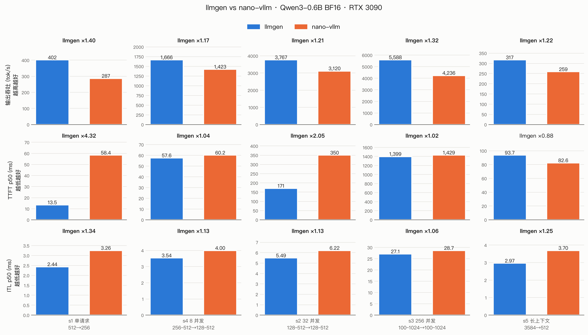

# llmgen

用 Zig + CUDA 从零实现的大模型推理引擎。不依赖 PyTorch，直接加载 GGUF 权重；在 RTX 3090 上跑 Qwen3-0.6B，5 个压测场景的输出吞吐都比 [nano-vllm](https://github.com/GeeeekExplorer/nano-vllm) 高 **17%–40%**。

## 主要特性

* 🚀 **吞吐和延迟都更好**：和 nano-vllm 用同一份 workload 对比，输出吞吐提升 1.17–1.40 倍，ITL 降低 5%–25%（见[性能对比](#性能对比)）
* 🧩 **从零实现**：GGUF 解析、BPE 分词、计算图、调度器、分页 KV Cache、CUDA kernel 全部自己写，约 1.1 万行 Zig 加 2.2 千行 CUDA
* ⚡ **服务级优化**：continuous batching（`prefill_first` / `chunked` 两种调度策略，KV 不够时抢占）、CUDA Graph 分桶回放、FlashAttention-2 prefill、split-K flash-decoding、GPU 采样
* 🖥️ **CPU / CUDA 双后端**：同一套计算图和执行层，CPU 后端是朴素实现，用作 CUDA 的正确性参考
* ✅ **可对拍**：greedy 输出带 `token ids`，每一步优化前后逐 token 比对；算子和 PyTorch 的结果比对

## 构建

需要 Zig 0.15.2（最低 0.15.1）。GPU 版本还需要 CUDA Toolkit，默认 `-Dcuda-arch=sm_86`（RTX 3090）。

```bash
make build          # CPU 版本
make build-cuda     # CUDA 版本（-Dcuda=true，调用 nvcc 编译 kernel）
```

## 模型

llmgen 读取 GGUF 格式的 BF16 权重，可以用 llama.cpp 的转换脚本从 Hugging Face 权重生成：

```bash
huggingface-cli download Qwen/Qwen3-0.6B --local-dir ~/huggingface/Qwen3-0.6B
python llama.cpp/convert_hf_to_gguf.py ~/huggingface/Qwen3-0.6B --outtype bf16 --outfile Qwen3-0.6B-BF16.gguf
export LLMGEN_MODEL=$PWD/Qwen3-0.6B-BF16.gguf   # 也可以用 --model 指定
```

## 快速开始

```bash
make run-cuda ARGS="chat 你好 64"        # GPU：greedy 生成，最多 64 个 token
make run      ARGS="chat 你好 64"        # CPU
make run-cuda ARGS="chat -i"             # 交互式多轮对话（/think 切换思考模式，/clear，/exit）
make run-cuda ARGS="bench bench/workloads/s3.json"   # 按 workload 压测，输出 JSON
make test / make test-cuda               # 单元测试
```

常用选项（完整列表见 `src/cli.zig`）：`--temp`、`--policy prefill_first|chunked`、`--chunk`、`--max-num-seqs`、`--max-model-len`、`--gpu-util`、`--kv-blocks`、`--eager`（不使用 CUDA Graph）、`--sync-each`（每个 kernel 后同步，用来定位出错的 kernel）。

> `make run` 和 `make run-cuda` 都输出到 `zig-out/bin/llmgen`，后一次构建会覆盖前一次。

## 性能对比



**测试配置**

- 硬件：NVIDIA RTX 3090（24 GB，driver 560.35，CUDA 12.6），Intel Xeon E5-2682 v4
- 模型：Qwen3-0.6B，BF16（llmgen 读 GGUF，nano-vllm 读 Hugging Face safetensors，权重相同）
- 对照：nano-vllm（torch 2.8.0 + flash-attn 2.8.3），开启 CUDA Graph
- 两边配置一致：`max_model_len=4096`、`max_num_seqs=256`、`max_num_batched_tokens=16384`、`gpu_memory_utilization=0.9`；采样 `temperature=0.6`，`ignore_eos=True`，所以两边输出的 token 数完全相同
- 每个场景两个引擎交替各跑 3 次，取中位数；各场景 3 次之间的吞吐波动 ≤ 1.2%

**场景**（`bench/gen_workload.py` 生成，两个引擎读同一份 JSON）

| 场景 | 请求 | 输入 → 输出 (token) | 关注点 |
|---|---|---|---|
| s1 | 1 条 × 5 轮 | 512 → 256 | 单请求的延迟 |
| s4 | 8 条 × 3 轮 | 256~512 → 128~512 | 小批量 decode |
| s2 | 32 条 | 128~512 → 128~512 | 中等并发 |
| s3 | 256 条 | 100~1024 → 100~1024 | **和 nano-vllm `bench.py` 完全相同**（随机种子和生成顺序一致） |
| s5 | 1 条 × 3 轮 | 3584 → 512 | 长上下文 |

**结果**

| 场景 | 引擎 | 输出吞吐 (tok/s) | TTFT p50 / p99 (ms) | ITL p50 / p99 (ms) | 墙钟 (s) |
|---|---|---:|---:|---:|---:|
| s1 单请求 | **llmgen** | **402** (×1.40) | **13.5** / 13.6 | **2.44** / 2.96 | 0.64 |
|  | nano-vllm | 287 | 58.4 / 59.6 | 3.26 / 3.65 | 0.89 |
| s4 8 并发 | **llmgen** | **1,666** (×1.17) | **57.6** / 58.2 | **3.54** / 3.96 | 1.77 |
|  | nano-vllm | 1,423 | 60.2 / 348.0 | 4.00 / 4.26 | 2.08 |
| s2 32 并发 | **llmgen** | **3,767** (×1.21) | **170.7** / 170.7 | **5.49** / 5.97 | 2.56 |
|  | nano-vllm | 3,120 | 350.2 / 350.2 | 6.22 / 6.55 | 3.09 |
| s3 256 并发 | **llmgen** | **5,588** (×1.32) | **1,398.7** / 2,477.7 | **27.11** / 30.49 | 23.97 |
|  | nano-vllm | 4,236 | 1,428.9 / 2,440.0 | 28.67 / 87.18 | 31.63 |
| s5 长上下文 | **llmgen** | **317** (×1.22) | 93.7 / 95.1 | **2.97** / 3.47 | 1.61 |
|  | nano-vllm | 259 | **82.6** / 84.5 | 3.70 / 3.94 | 1.98 |

和 nano-vllm README 同口径的数字（s3，256 条请求，共 133,966 个输出 token）：

| 推理引擎 | 输出 token | 耗时 (s) | 吞吐 (tokens/s) |
|---|---:|---:|---:|
| nano-vllm（官方 `bench.py`） | 133,966 | 31.53 | 4,248 |
| nano-vllm（`bench/nanovllm_bench.py`） | 133,966 | 31.63 | 4,236 |
| **llmgen** | 133,966 | **23.97** | **5,588** |

前两行用来校验对比脚本：同一台机器上，nano-vllm 官方 `bench.py` 和本仓库驱动 nano-vllm 的脚本相差 0.3%，说明这个脚本几乎没有引入额外开销。

**怎么读这些数**

- **decode 更快**：所有场景的 ITL p50 都更低（-5% 到 -25%）。decode 阶段带宽是瓶颈，llmgen 用 bf16x8 向量化访存、小批量 GEMV、split-K flash-decoding，整步录进 CUDA Graph，每步只有一次同步、只拷回采样出的 token id，host 端也没有 Python 调度开销。
- **短 prompt 的 TTFT 优势最大**：s1 的 TTFT 是 nano-vllm 的 1/4，s2 是 1/2。prompt 短时 prefill 的计算量小，launch 和 host 端开销占比大，llmgen 一步只同步一次，nano-vllm 还有 Python 调度开销（这是推测，没有逐项拆分验证）。
- **长 prompt 的 prefill 还落后**：s5（3584 token 的 prompt）TTFT 比 nano-vllm 慢 13%，推测是自己写的 FA2 prefill kernel 在长序列上还比不上官方 flash-attn，这是下一步要优化的地方。
- **高并发下尾延迟更稳**：s3 的 ITL p99 是 30.5 ms，nano-vllm 是 87.2 ms。
- **其他**：llmgen 加载用时 1.3 s（含录 CUDA Graph），nano-vllm 是 11.9 s；进程峰值 RSS 分别是 0.6 GB 和 2.3 GB。两边的 KV 容量都在 17.5 万 token 左右。

**复现**

```bash
make workloads     # 生成 bench/workloads/s1~s5.json
make compare       # bench/compare.sh：两个引擎交替跑，结果写到 bench/results/*.json
make plot          # bench/plot.py：打印上面的表格，生成 docs/images/bench-compare.png（需要 matplotlib）
```

`bench/nanovllm_bench.py` 用 nano-vllm 的 `LLMEngine.step()` 驱动同一份 workload，指标口径和 `llmgen bench` 一致：TTFT 是从提交到首 token 回到 host 的时间，ITL 是同一请求相邻两个 token 的间隔，吞吐是输出 token 数除以墙钟时间。原始结果保存在 `bench/results/`。

## 优化历程

从第一个能跑通的版本到现在，用同一种方法测量（`bench/run.sh`：单请求，同一个 21 token 的默认 prompt，每个 token 的平均 decode 速度），decode 从 **15.5 tok/s** 提到 **413 tok/s**（×26.7），TTFT 从 423 ms 降到 **4.5 ms**。基线结果在 `bench/40da889-dirty/`。整个过程共 23 步，每一步的原理、改动和收益见教程 [一步步优化到 serving](docs/llmgen-serving-unfused/index.html)：

| 阶段 | 内容 |
|---|---|
| 减少 host 开销 | 全图放到 GPU；每步的元数据打成一包，一次上传；整步只用一条 stream，只同步一次；GPU 采样 |
| 少做无用功 | 拆分 head 不发 kernel，零拷贝；写 KV 合并成一个 kernel；prefill 的 lm_head 只算最后一行 |
| kernel 优化 | bf16x8 向量化；RMSNorm / RoPE 按行宽选线程映射；GEMV + cuBLAS；split-K flash-decoding；FA2 prefill |
| 服务化 | 按活跃区间规划激活内存；CUDA Graph；序列级块表和 KV 预算；批量前向；调度策略和抢占 |

## 架构

```
GGUF ──► GGUFParser ──► ModelFactory(Qwen3) ──► 计算图 ──► GraphScheduler(设备分配 / 显存预算)
                                                                   │
请求 ──► Engine ──► BatchScheduler(prefill_first | chunked, 抢占) ──► Executor(CUDA Graph / eager)
            ▲                       │ BlockManager(分页 KV)              │
            └──── postprocess ◄──── 采样出的 token ◄──── backend/{cpu,cuda} 算子
```

```
src/
├── llmgen.zig cli.zig        入口、命令行（chat / bench）
├── gguf.zig tokenizer.zig    GGUF 解析、BPE 分词
├── models/ module/           Qwen3 模型定义、层模块（linear / norm / rope / attention ...）
├── graph/                    计算图、图调度（设备分配、显存预算）
├── memory/                   内存规划、池化、分页 KV
├── executor.zig              前向执行、CUDA Graph 录制和回放
├── runner/                   服务引擎、批调度、块管理
├── backend/{cpu,cuda}/       算子实现
└── profiler/ bench/          性能统计、压测记录
bench/     压测和对比脚本、结果     docs/     设计文档和教程     testdata/     算子对拍数据（来自 PyTorch）
```

## 文档

- [推理主流程](docs/flow.md) · [GGUF](docs/gguf.md) · [模型映射](docs/model.md) · [计算图](docs/graph.md) · [图调度](docs/scheduler.md) · [执行器](docs/executor.md)
- [分词器](docs/tokenizer.md) · [内存与 KV Cache](docs/memory.md) · [设备派发](docs/device.md) · [算子](docs/ops.md) · [连续批处理](docs/batching.html)
- [性能指标实战](docs/perf-metrics.html) · [性能优化教程：一步步优化到 serving](docs/llmgen-serving-unfused/index.html)

## 参考

- [nano-vllm](https://github.com/GeeeekExplorer/nano-vllm) · [vLLM](https://github.com/vllm-project/vllm) · [llama.cpp](https://github.com/ggml-org/llama.cpp) · [FlashAttention](https://github.com/Dao-AILab/flash-attention)
