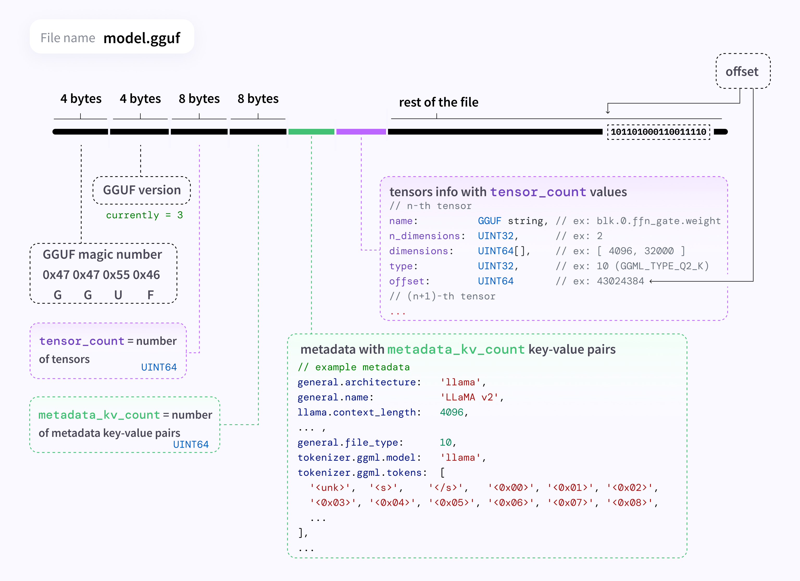

# 解析 GGUF 模型

## GGUF 格式

GGUF 格式用一个文件，包含运行一个大模型所需的一切模型参数，目的是为快速、低内存加载而极致优化，其实就是一个模型的压缩包

一个GGUF文件由四个连续的部分组成：

文件头 (Header): 文件的身份标识和“目录”
元数据 (Metadata): 模型的“说明书”，记录了架构、分词器等一切信息，以 key-value 形式组织
张量信息 (Tensor Info): 模型权重的“索引”，描述了每个权重块的尺寸、类型和位置
张量数据 (Tensor Data): 模型真正的“大脑”，即所有权重的二进制数据，通过 offset 截取

## 基本信息

- header
    - magic
    - version
    - tensor_count
    - metadata_kv_count
- metadata - 全局模型配置参数
    - key
    - value - 数据类型各不相同
- tensor_info_array
- tensor_data

## 类组织结构

- GGUFParser 
    - GGUFInfo
- GGUFInfo
    - version
    - tensor_count
    - metadata_kv_count
    - metadata
        - metadata_kv_map
    - []TensorInfo
    - data_offset
- TensorInfo
    - name
    - n_dim
    - shape - shape 重构 ?
    - data_type
    - offset

## 解析流程

- 从文件中读取 data buffer
- parse header
- parse metadata
- parse tensor infos
- parse data offset

## 辅助类

- ByteReader - 按照指定数量读取字节内容

## 参考资料

- https://donge.org/posts/2025-gguf/
- https://donge.org/posts/2025-gguf-inspector/
- https://github.com/karminski/one-small-step/blob/main/20250113-what-is-gguf/what-is-gguf.md